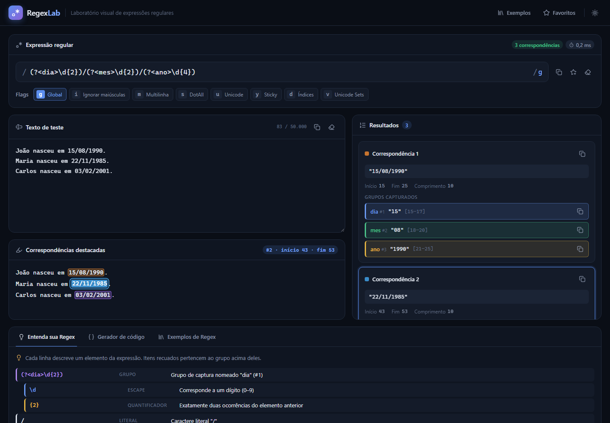

<div align="center">

# RegexLab

**Laboratório visual de expressões regulares — crie, teste, analise e entenda Regex em tempo real.**




</div>

---

## Sobre o projeto

O **RegexLab** é uma ferramenta para desenvolvedores que precisam escrever, depurar ou entender expressões regulares. Cada alteração na expressão, nas flags ou no texto é refletida imediatamente: as correspondências são destacadas, os grupos capturados aparecem com suas posições e a estrutura da expressão é explicada em português.

Tudo roda **localmente no navegador**: não há backend, banco de dados, autenticação nem chamadas a serviços externos. As expressões do usuário são executadas em **Web Workers descartáveis**, com tempo limite. Assim, mesmo uma regex com backtracking catastrófico, como `(a+)+$`, não trava a interface.

## Funcionalidades

| Recurso | Descrição |
|---|---|
| **Editor de expressão** | Validação em tempo real, mensagens de erro, copiar/limpar e seleção das flags `g i m s u y d v`. As flags `u` e `v` são mutuamente exclusivas, e flags não suportadas pelo navegador ficam desabilitadas. |
| **Teste em tempo real** | O processamento é automático, com *debounce*, sem botão de executar. |
| **Destaque visual** | Correspondências em cores alternadas, marcador para correspondências vazias e seleção com índices inicial e final. A renderização é segura, sem `innerHTML`. |
| **Painel de resultados** | Número, texto, início, fim, comprimento e grupos capturados, numerados e nomeados, com suas posições. |
| **Entenda sua Regex** | Parser estrutural próprio que respeita escapes, classes, grupos, lookarounds e quantificadores. Construções desconhecidas recebem uma indicação neutra. |
| **Gerador de código** | Exemplos em JavaScript, TypeScript e Java (`Pattern`/`Matcher`), com os escapes corretos de cada linguagem e avisos de incompatibilidade. |
| **Exemplos prontos** | 10 expressões (e-mail, CPF, CNPJ alfanumérico, telefone, CEP, data, horário, números, letras, URL), cada uma com casos válidos e inválidos. |
| **Favoritos** | Salvar, listar, editar, excluir e carregar, com persistência no LocalStorage. |
| **Temas** | Escuro (padrão) e claro, com a preferência persistida. |
| **Responsivo** | Layout adaptado para desktop, tablet e celular. |

## Stack

- **Angular 22**: standalone components, zoneless, `ChangeDetectionStrategy.OnPush`
- **Signals**: `signal`, `computed`, `linkedSignal`, `effect` e `afterRenderEffect`
- **Nova sintaxe de templates**: `@if`, `@for`, `@switch`, `@let`
- **Reactive Forms** no formulário de favoritos
- **TypeScript** em modo `strict`, com `strictTemplates`
- **SCSS** com design tokens em CSS custom properties
- **Lucide** (`@lucide/angular`) para ícones
- **Vitest** com jsdom, via `@angular/build:unit-test`
- **Web Workers** nativos, empacotados pelo Angular CLI

Não usa NgModules, NgRx, jQuery nem bibliotecas de UI.

## Começando

### Pré-requisitos

- Node.js em versão suportada pelo Angular 22 (desenvolvido com Node 24 e npm 11)

### Instalação e execução

```bash
npm install
npm start          # ng serve → http://localhost:4200
```

### Scripts

| Comando | Descrição |
|---|---|
| `npm start` | Servidor de desenvolvimento com recarga automática |
| `npm run build` | Build de produção em `dist/regexlab/browser` |
| `npm test` | Testes em modo *watch* |
| `npm run test:ci` | Execução única dos testes (CI) |

O build de produção gera arquivos estáticos que podem ser publicados em qualquer hospedagem estática, como GitHub Pages, Netlify, Vercel ou S3.

## Arquitetura

A organização é **por funcionalidade**. A lógica de processamento fica em serviços e funções puras, e os componentes cuidam apenas da apresentação.

```
src/app/
├── core/                         # Serviços e configurações globais
│   ├── config/regex-lab.config.ts    # Limites configuráveis (InjectionToken)
│   ├── layout/app-header/            # Cabeçalho
│   ├── models/regex.models.ts        # Tipos de domínio
│   └── services/
│       ├── regex-lab.store.ts        # Estado central com Signals + debounce
│       ├── theme.service.ts
│       ├── storage.service.ts        # LocalStorage tolerante a falhas
│       └── clipboard.service.ts
├── shared/                       # Reutilizáveis
│   ├── components/copy-button/
│   └── utils/                        # flags, validação, grupos, realce de código
└── features/
    ├── regex-editor/                 # Campo da expressão + seletor de flags
    ├── regex-matcher/
    │   ├── engine/                   # Motor puro, Web Worker e segmentação de destaques
    │   ├── services/                 # RegexRunnerService (worker, timeout, cancelamento)
    │   └── components/               # Texto de teste, texto destacado, lista de resultados
    ├── regex-explainer/              # Parser estrutural + painel "Entenda sua Regex"
    ├── regex-examples/               # Biblioteca de exemplos
    ├── regex-favorites/              # Serviço, gaveta e formulário de favoritos
    └── code-generator/               # Geração de código JS/TS/Java
```

### Fluxo de processamento

```
 digitação ──► RegexLabStore (signals)
                  │  validation = computed(...)  ← apenas compila o RegExp, sem executar busca
                  │
                  ▼  effect + debounce (200 ms)
            RegexRunnerService
                  │  cancela a execução anterior (worker.terminate)
                  │  cria um Web Worker novo (descartável)
                  ▼
            regex.worker.ts → executeRegex()      ← motor nativo do JavaScript
                  │
       ┌──────────┼─────────────────┐
   resposta    timeout (1,5 s)    nova digitação
       │          │                 │
       ▼          ▼                 ▼
   resultado   worker encerrado   worker encerrado
   na tela     + aviso na UI      (resultado ignorado)
```

**Decisões importantes:**

- **Nenhuma busca na thread principal.** A thread principal só *compila* a expressão para validar a sintaxe, o que é seguro. A busca acontece sempre no worker.
- **Correspondências vazias.** Quando o resultado é vazio, o `lastIndex` avança manualmente, por *code point* nos modos `u`/`v`. Isso evita laços infinitos com expressões como `a*` ou `^`.
- **Semântica de `g` e `y` preservada.** Sem `g`, apenas a primeira correspondência é retornada. Com `y`, a busca respeita a posição exata. Com `gy`, ela para na primeira lacuna.
- **Posições dos grupos.** O worker adiciona a flag `d` internamente para obter os índices dos grupos, o que não altera o que é encontrado. Os nomes dos grupos vêm de uma varredura da expressão que respeita escapes e classes.
- **Renderização segura.** O texto é dividido em segmentos e renderizado por interpolação. Nenhum HTML é gerado a partir do conteúdo do usuário.

### Limites configuráveis

Os limites ficam em [`regex-lab.config.ts`](src/app/core/config/regex-lab.config.ts) e podem ser sobrescritos via DI:

| Limite | Padrão | Efeito |
|---|---|---|
| `maxTextLength` | 50.000 caracteres | Acima disso o texto não é processado e um aviso é exibido |
| `maxMatches` | 500 | A coleta é interrompida e o aviso "limite atingido" aparece |
| `timeoutMs` | 1.500 ms | O worker é encerrado e o usuário é avisado |
| `debounceMs` | 200 ms | Espera após a digitação antes de processar |

```ts
// app.config.ts
providers: [
  { provide: REGEX_LAB_LIMITS, useValue: { ...DEFAULT_REGEX_LAB_LIMITS, timeoutMs: 3_000 } },
];
```

## Gerador de código e compatibilidade

O código gerado usa a expressão **sem tradução automática**. Quando um recurso não tem equivalente ou tem semântica diferente na linguagem de destino, o RegexLab mostra um aviso em vez de converter. Alguns exemplos para Java:

| Recurso em JavaScript | Aviso exibido |
|---|---|
| Flag `y` (sticky) e flag `v` | Sem equivalente direto em `java.util.regex` |
| `\u{1F600}` | Java usa `\x{...}` |
| `$` sem a flag `m` | Em Java também corresponde antes de uma quebra de linha final |
| `\s`, `\v`, `\0` | Semântica diferente ou sintaxe inválida |
| `[^]`, `[]`, `[` e `&&` dentro de classes | Significado diferente em Java |
| Lookbehind com `*`, `+` ou `{n,}` | Não suportado em Java |
| Nomes de grupo com `_` | Java aceita apenas letras ASCII e dígitos |

As flags `i`, `m` e `s` são mapeadas para `CASE_INSENSITIVE`, `MULTILINE` e `DOTALL`. Com `u`/`v`, a flag `i` também recebe `UNICODE_CASE`.

## Testes

```bash
npm run test:ci
```

São **108 testes** em 10 arquivos. Eles cobrem:

- validação de expressões, expressões inválidas e flags incompatíveis (`u` + `v`);
- correspondências globais, não globais, *sticky* e de comprimento zero (inclusive Unicode);
- grupos numerados, grupos nomeados e grupos que não participaram;
- ausência de correspondências e limite de resultados;
- **timeout e cancelamento** dos workers, com um worker falso que nunca responde;
- persistência de favoritos (criar, editar, excluir, dados corrompidos);
- geração de código, incluindo a execução real do código JavaScript gerado e os escapes em Java;
- explicação dos principais tokens pelo parser;
- validação dos 10 exemplos contra seus casos válidos e inválidos;
- **atualização reativa da interface**: digitação, destaques, seleção, erros, exemplos e código.

## Observações

- As expressões de **CPF, CNPJ e datas validam apenas o formato**. Dígitos verificadores e a existência real de uma data (ex.: 31/02) exigem validação adicional.
- O explicador não é um parser completo de ECMAScript. Construções não reconhecidas, como operações de conjunto do modo `v`, recebem uma descrição neutra.
- A flag `v` depende do suporte do navegador e fica desabilitada automaticamente quando não está disponível.

---

<div align="center">
Desenvolvido com Angular · processamento 100% local
</div>
